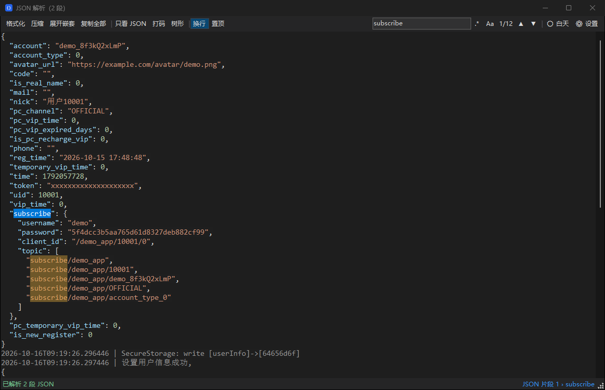
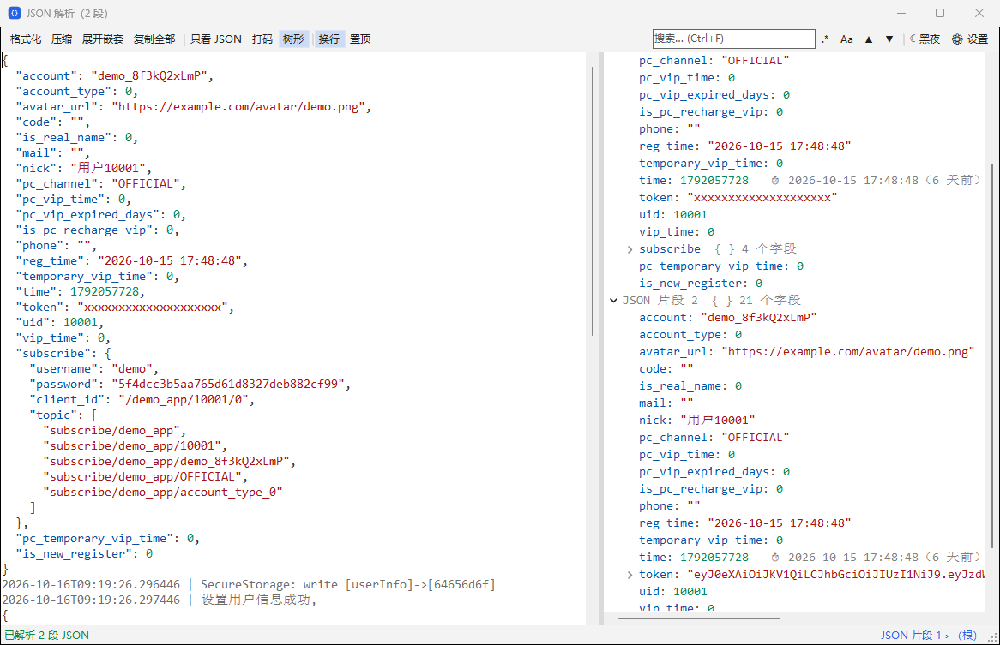
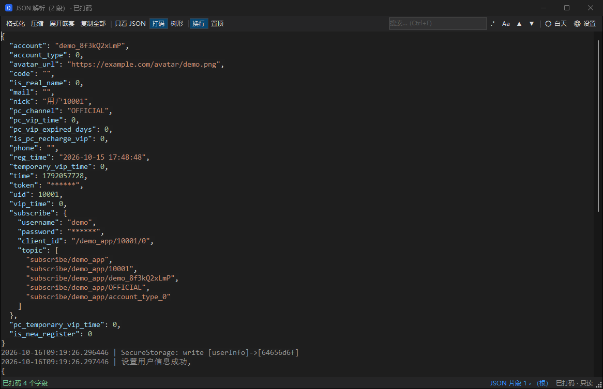

# JSON 解析助手 (JsonRightClick)

在任意程序里选中一段含 JSON 的文本（日志、接口返回、聊天记录……），右键即可把其中的 JSON 格式化后在独立窗口查看、编辑、复制。窗口内容不会写回原文件。

[English](#english)



| 树形视图（浅色） | 敏感字段打码 |
| --- | --- |
|  |  |

## 功能

- **选中文本即用**：选中文字后右键时出现悬浮的「解析 JSON」按钮；也可用全局快捷键（默认 `Ctrl+Alt+J`，可自定义）或托盘菜单解析剪贴板。
- **资源管理器右键菜单**：右键 .log / .json / .txt 等文件「用 JSON 解析助手打开」。Win11 下可放在第一层菜单（需开发人员模式），也可用经典菜单。
- **混合文本**：从日志里提取多段 JSON，非 JSON 内容原样保留；「只看 JSON」模式下的修改会合并回全文。
- **查看工具**：树形视图、JSON 路径、全部匹配高亮搜索（支持正则 / 大小写）、敏感字段打码、JWT 解码、时间戳提示、展开嵌套 JSON 字符串、宽松解析（单引号、尾逗号、注释、Python 字面量）、压缩 / 格式化。
- **括号配对**：点击 `{` / `}` / `[` / `]`，或用方向键把光标移到括号旁，会同时高亮对应的一对括号；另一端超出可视区域时，编辑区顶部或底部显示对应行预览，点击预览即可跳转。展开嵌套、压缩、撤销、只看 JSON、打码及大文件模式下均可使用；字符串内的括号不会误匹配。
- **代码折叠**：编辑区左侧点击 `− / +` 手动折叠或展开对象 / 数组；收起后点击 `{…}` / `[…]` 可展开。工具栏「折叠」及右键「代码折叠」支持当前层级、全部折叠 / 展开；子层级的独立折叠状态会保留。折叠只改变显示，复制、格式化和撤销使用的仍是完整原文，搜索或树形定位会自动展开目标。
- **悬停提示**：嵌套 JSON 字符串、JWT、时间戳的提示跟随鼠标，在同一段长文本内移动也会更新位置；靠近屏幕边缘自动调整，滚动、编辑或离开编辑区后隐藏。
- **界面**：深色 / 浅色主题、导入字体（保存在程序目录 `Fonts\`）、字号记忆、中英文切换、开机自启。
- 单个 exe，只依赖 Windows 自带的 .NET Framework 4.x，**不联网**。

### 折叠快捷键

| 操作 | 快捷键 |
| --- | --- |
| 折叠当前层级 | `Ctrl+Shift+[` |
| 展开当前层级 | `Ctrl+Shift+]` |
| 全部折叠 | `Ctrl+Alt+[` |
| 全部展开 | `Ctrl+Alt+]` |

在折叠块边界按 Backspace / Delete 会先展开，避免误删隐藏内容；再次按键才进行普通删除。

## 系统要求

- Windows 10 / 11（Win11 第一层右键菜单需要打开「开发人员模式」）
- .NET Framework 4.7.2 或更高（Win10 1803+ 自带）

## 使用

1. 从 [Releases](../../releases) 下载，或自己编译（见下）。
2. 把 `JsonRightClick.exe` 和 `JsonRightClickMenu.exe` 放在同一个**固定的、可写的**文件夹里（不要放在 Program Files，设置文件要写在程序旁边）。
3. 运行 `JsonRightClick.exe`，程序驻留托盘并自动注册右键菜单。

> 目标程序以管理员身份运行时，Windows 不允许普通程序读取它的选中内容，可在托盘菜单里选择「以管理员身份重新启动」。

## 编译

不需要 Visual Studio：

```bat
build.bat
```

使用系统自带的 `csc.exe` 生成两个 exe：

| 文件 | 作用 |
| --- | --- |
| `JsonRightClick.exe` | 主程序：托盘、悬浮按钮、查看窗口 |
| `JsonRightClickMenu.exe` | Win11 第一层右键菜单的 COM 服务（带稀疏包身份，manifest 见 `appmenu.manifest`） |

## 卸载

1. 托盘菜单 →「资源管理器右键菜单」→ 关闭（会同时移除稀疏包和经典菜单注册表项）。
2. 关闭「开机自动启动」，然后退出。
3. 删除程序文件夹。

## 数据与隐私

- 设置保存在程序目录的 `settings.ini`（删除即恢复默认），目录不可写时回退到 `HKCU\Software\JsonRightClick`。
- 程序不发起任何网络请求，解析的内容只在内存中，不会保存。

## 自检

```bat
JsonRightClick.exe --selftest samples\sample.log out.txt
JsonRightClick.exe --uitest samples\sample.log out.txt
```

`samples/sample.log` 中的账号、令牌均为虚构数据。

编辑器交互回归测试（Windows，使用系统自带的编译器，无需额外测试依赖）：

```powershell
.\tests\run-tests.ps1
```

测试产物位于 `.test-output/`，覆盖括号匹配、代码折叠与父子状态、折叠复制及撤销、搜索 / 树形定位、嵌套展开、视图切换、长文本提示定位、屏幕边界和大文件着色；不改写现有程序的显示设置。

## License

[MIT](LICENSE)

---

## English

**JsonRightClick** formats JSON embedded in any selected text (logs, API responses, chat messages) and shows it in a separate editable window. Nothing is written back to the source.

- Select text → right-click → floating **Parse JSON** button, or a global hotkey (default `Ctrl+Alt+J`), or parse the clipboard from the tray.
- File Explorer context menu for .log / .json / .txt files (Windows 11 top-level menu via a sparse package with Developer Mode, or the classic menu).
- Keeps non-JSON text intact; edits made in *JSON only* mode are merged back.
- Tree view, JSON path, highlight-all search with regex, sensitive-field masking, JWT decoding, timestamp hints, nested-JSON expansion, lenient parsing.
- Matching-bracket highlights, with a clickable line preview when the other bracket is off screen; works after expanding nested JSON strings.
- IDEA-style code folding with a left gutter, clickable placeholders, current/all-level menu actions and keyboard shortcuts; the complete source text and editing undo history are retained.
- Hover hints follow the pointer, including within very long wrapped strings, and stay within the screen.
- Dark / light theme, custom fonts, remembered font size, Chinese / English UI, start with Windows.
- Single exe on the built-in .NET Framework 4.x. No network access.

Build with `build.bat` (no Visual Studio needed). Keep both exes in the same writable folder and run `JsonRightClick.exe`. To uninstall, turn off the context menu and autostart from the tray menu, exit, and delete the folder.
