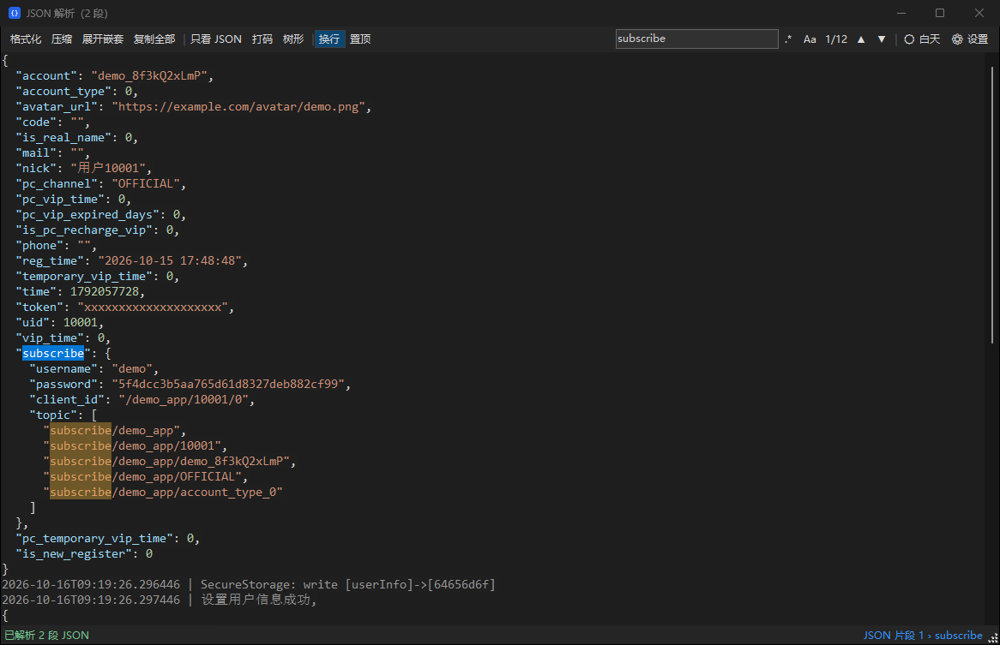
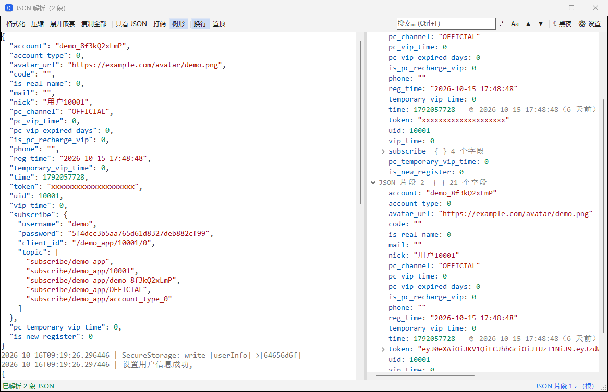
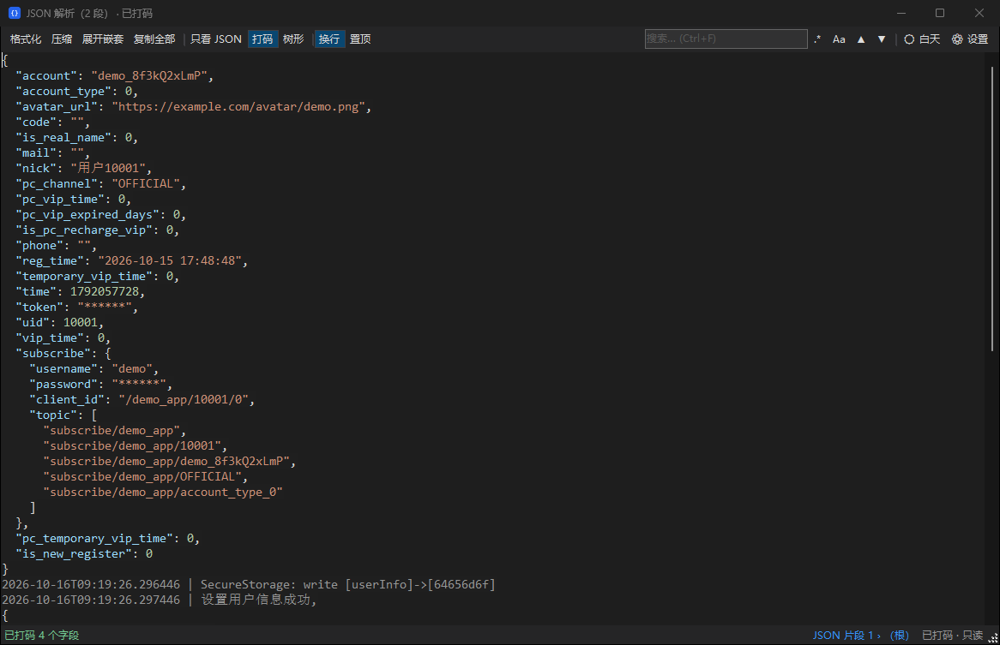

# JSON 解析助手 · JsonRightClick

选中一段日志或接口响应，右键就能在独立窗口查看其中的 JSON。可以格式化、搜索、折叠和编辑；找不到可解析的 JSON 时，仍可查看和编辑原文。解析在本机完成，编辑不会写回源文件。

[下载发布版][releases] · [Actions 构建][builds] · [English](#english)

## 快速上手

**系统要求：** Windows 10 / 11，.NET Framework 4.7.2 或更高的 4.x 版本。

1. **下载并解压。** 本文以 `main` 为准，有两种下载方式：
   - **正式发布版：** 在 [Releases][releases] 的 **Assets** 中下载 `JsonRightClick-*.zip`，不要选 *Source code*。
   - **main 分支构建：** 想用发布版还没有的功能时，登录 GitHub 后打开 [Actions 构建][builds]，选一条 `main` 分支的成功记录，在 **Artifacts** 中下载 `JsonRightClick`。
2. **运行主程序。** 把两个 EXE 放在同一个固定、可写的目录（不建议放在 `Program Files`），运行 `JsonRightClick.exe`。程序会在系统托盘驻留；无需单独运行 `JsonRightClickMenu.exe`。
3. **打开内容。** 在其他应用里选中文字，右键后点光标旁的 **解析 JSON**，或按默认快捷键 `Ctrl+Alt+J`（可在托盘菜单修改）。也可以按下表选择入口：

   | 要打开的内容 | 操作 |
   | --- | --- |
   | 剪贴板 | 双击托盘图标，或选「解析剪贴板中的 JSON」 |
   | `.log`、`.json`、`.txt` 等文件 | 从托盘选「打开文件…」，或在资源管理器右键选「用 JSON 解析助手打开」 |
   | 想手动粘贴的内容 | 从托盘打开空白窗口，粘贴后按 `Ctrl+Enter` 格式化 |

第一次使用可以打开[示例日志](samples/sample.log)，试试从同一份日志里提取多段 JSON。示例与截图中的账号、令牌均为虚构数据。

## 界面预览



<details>
<summary>查看更多截图：浅色树形视图、敏感字段打码</summary>

| 浅色树形视图 | 敏感字段打码 |
| --- | --- |
|  |  |

</details>

## 主要功能

| 你想做什么 | 对应功能 |
| --- | --- |
| **整理混合日志** | 提取多段 JSON 对象或数组，保留非 JSON 日志；可格式化、压缩。切换「只看 JSON」后编辑片段，再切回时会合并修改；有多个片段时请保留分隔标题行。 |
| **逐行对比数组元素** | 「智能收紧」让短普通数组保持单行、对象数组每项一行，复杂或过长的对象自动展开。也可选择「数组全部单行」或「全部展开」，不省略数据。 |
| **在长文本中定位字段** | `Ctrl+F` 高亮全部匹配，支持正则和大小写选项；树形视图可跳转到字段并复制 JSON 路径。编辑区支持折叠、括号配对和可点击的屏外配对行预览。折叠只影响显示，不删除文本。 |
| **查看嵌套值** | 展开嵌套 JSON 字符串，查看时间戳提示，或解码 JWT。JWT 解码只展示内容，**不验证签名**。 |
| **截图或复制前打码** | 将命中的敏感 JSON 字段和识别出的 JWT 打码；打码时只读，复制的是显示内容。普通日志文本不会自动脱敏，分享前仍需检查。 |

界面支持深浅主题、自定义字体和字号、软换行、窗口置顶及中英文切换。窗口变窄时工具栏自动换行，保留搜索内容。渐变光标与拖尾可分别开关；大文本按视口分批着色。

<details>
<summary>智能收紧示例</summary>

短普通数组保持单行，简单对象在数组中各占一行，方便比较字段：

```json
{
  "tags": ["api","prod"],
  "requests": [
    {"path": "/health", "status": 200},
    {"path": "/users", "status": 503}
  ]
}
```

包含复杂嵌套、字段超过 6 个或行宽超出约 120 字符预算的对象会按需展开。排版保留属性顺序、重复键、数值精度、类型和字符串转义。`Ctrl+Z` 可撤销排版，点「格式化」可恢复普通多行缩进。

</details>

<details>
<summary>转义 JSON 与宽松解析</summary>

- 支持完整的 JSON 字符串字面量或无外层引号的转义 JSON，最多解码 4 层。只有解码后整段内容是合法对象或数组时才采用，不会全局删反斜杠，也不会自动展开普通 JSON 中的字符串字段。
- 启用「宽松解析」后，可处理单引号、尾逗号、注释和 Python 字面量，也能尝试转换 `{ip: 192.0.2.1, country: CN, online: true}` 之类的 Map 展示文本。状态栏会提示类型推断；已经丢失的类型信息无法恢复，含歧义分隔符的值仍需加引号。能控制数据来源时，优先输出标准 JSON。

</details>

## 常用快捷键

| 操作 | 快捷键 |
| --- | --- |
| 从选区打开（全局，默认） | `Ctrl+Alt+J` |
| 格式化 / 撤销 | `Ctrl+Enter` / `Ctrl+Z` |
| 搜索 / 下一个 / 上一个 | `Ctrl+F` / `F3` / `Shift+F3` |
| 折叠 / 展开当前层级 | `Ctrl+Shift+[` / `Ctrl+Shift+]` |
| 折叠 / 展开全部 | `Ctrl+Alt+[` / `Ctrl+Alt+]` |

## 常见问题

- **右键没出现「解析 JSON」？** 只有源应用能确认文字选区时才会显示。密码框被排除；没有文字选区、控件不提供选区或响应超时，也不会弹出。可以先手动复制，再双击托盘图标。
- **在终端里怎么用？** 先手动复制，再解析剪贴板。工具不会在终端自动发送 `Ctrl+C`，以免中断正在运行的程序。
- **目标窗口以管理员身份运行？** 可以手动复制后解析；需要直接取词时，可在托盘菜单选择「以管理员身份重新启动」。
- **Win11 右键文件没找到菜单？** 经典模式在「显示更多选项」里。需要第一层菜单时，可在托盘的「资源管理器右键菜单」中切换到 Win11 第一层模式；只有这个模式需要开启开发人员模式。
- **日志大于 20 MB？** 打开时可选择只读前 20 MB、全部加载或取消，不会改动文件。

## 本地设置与卸载

- **设置：** 通常保存在程序旁的 `settings.ini`；目录不可写时回退到 `HKCU\Software\JsonRightClick`。
- **剪贴板：** 取词优先直接读取选区，回退到复制时才会临时使用系统剪贴板。默认尝试恢复原剪贴板，不覆盖后续复制的新内容。
- **卸载：** 在托盘将「资源管理器右键菜单」设为「关闭」，取消「开机自动启动」，退出程序，再删除程序目录。

## 从源码构建

在 Windows 的仓库根目录运行以下命令。构建使用 .NET Framework 的 `csc.exe`，无需 Visual Studio。

```powershell
.\build.bat
```

生成 `JsonRightClick.exe`（托盘和查看器）与 `JsonRightClickMenu.exe`（Win11 第一层菜单的 COM 服务）。使用时将两个文件放在同一目录。

<details>
<summary>自检、无界面测试与交互回归</summary>

样例自检及无界面测试不打开编辑窗口：

```powershell
.\JsonRightClick.exe --selftest .\samples\sample.log selftest.txt
.\tests\run-array-headless-tests.ps1
.\tests\run-toolbar-headless-tests.ps1
.\tests\run-caret-headless-tests.ps1
```

编辑器回归和滚动基准会打开窗口，建议在桌面空闲时或 CI 环境中运行：

```powershell
.\JsonRightClick.exe --uitest .\samples\sample.log uitest.txt
.\tests\run-tests.ps1
.\tests\run-scroll-benchmark.ps1 -BaselineRef 88b0707
```

测试产物保存在 `.test-output/`；两个自检命令各自写入指定的报告文件。为光标测试添加 `-Preview` 可生成离屏示意帧。滚动基准需要本地 Git 历史中的对比提交，报告帧投递、绘制、补色和选区事件等指标。

</details>

## English

**JsonRightClick** opens selected text, clipboard contents, or local files in a Windows JSON viewer. It extracts and formats JSON within mixed logs, keeps text it cannot parse, and never writes edits back to the source file. Parsing runs locally.

**Requirements:** Windows 10 or 11 and .NET Framework 4.7.2 or later in the 4.x series.

1. Download the ZIP from [Releases][releases]. This README describes `main`; for features not yet in a release, sign in to GitHub, open a successful `main` run under [Actions][builds], and download the `JsonRightClick` artifact.
2. Extract both executables into the same writable folder. Run `JsonRightClick.exe`; it stays in the system tray.
3. Select text and right-click → **Parse JSON**, or press `Ctrl+Alt+J` (default). You can also double-click the tray icon to parse the clipboard or choose **Open file…** from the tray menu.

The viewer includes smart array layout, JSON-only editing, regex search, code folding and bracket matching, a tree view with JSON paths, sensitive-field masking, nested JSON expansion, timestamp hints, and JWT decoding without signature verification.

**No floating button?** Some apps do not expose their selection. Copy the text manually and use the tray; in terminals the tool never sends `Ctrl+C`. On Windows 11, the classic file menu is under **Show more options**. Only the optional top-level Explorer menu needs Developer Mode.

**Build** with `build.bat` on Windows; Visual Studio is not required. **Uninstall** by turning off the Explorer menu and auto-start from the tray, exiting, and deleting the folder.

## License

[MIT](LICENSE)

[releases]: https://github.com/Emptysky281/JsonRightClick/releases/latest
[builds]: https://github.com/Emptysky281/JsonRightClick/actions/workflows/build.yml
